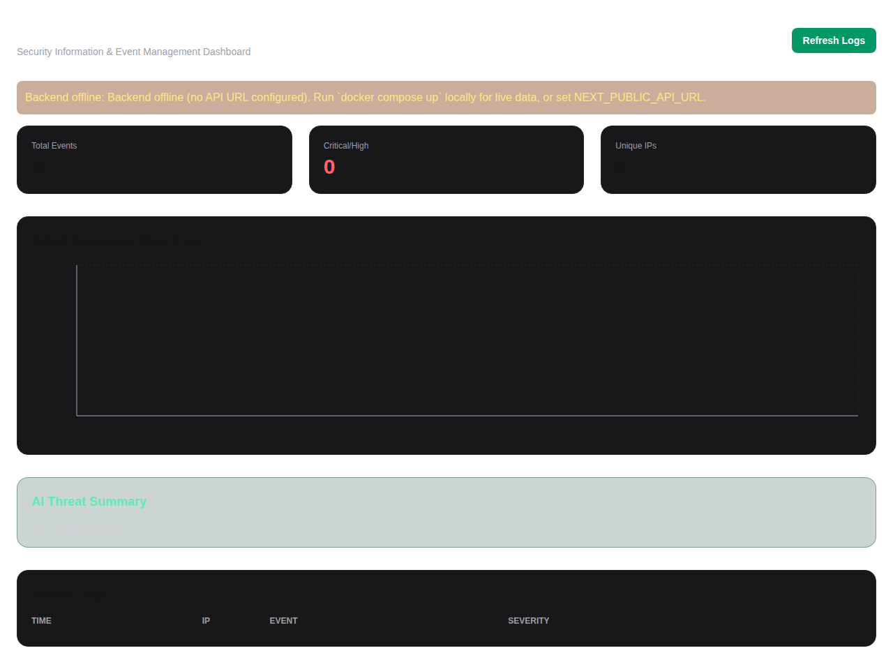

# 🛡️ SentinelLog AI

A lightweight **Security Information and Event Management (SIEM)** dashboard that ingests server logs, visualizes attack attempts, and uses AI to summarize threats.

## 🔗 Live Demo
**[View Live Site →](https://sentinellog-ai.vercel.app)**

## 📸 Screenshots


## ✨ Features
- 📊 Real-time attack frequency chart (Recharts)
- 📋 Raw log table with IP, event, severity
- 🤖 AI threat summary (OpenAI or offline fallback)
- 🔄 Refresh logs on demand
- 🐳 One-command Docker Compose setup
- 🔌 REST API (FastAPI) + SQLite storage

## 🛠️ Tech Stack
**Frontend:** Next.js 16 (App Router), Tailwind CSS, Recharts, TypeScript
**Backend:** FastAPI, SQLAlchemy, SQLite
**AI:** OpenAI API (optional, offline fallback included)
**Infra:** Docker Compose, GitHub Actions CI

## 🏗️ Architecture
```
frontend (Next.js)  -->  backend (FastAPI)  -->  SQLite
                              |
                              +-->  OpenAI API (optional)
```

## 🚀 Run Locally

### With Docker (recommended)
```bash
docker compose up --build
```
Frontend: http://localhost:3000 · Backend: http://localhost:8000

### Manual
Backend:
```bash
cd backend
python -m venv .venv && source .venv/bin/activate
pip install -r requirements.txt
uvicorn app.main:app --reload
```
Frontend:
```bash
cd frontend
npm install && npm run dev
```

Set `OPENAI_API_KEY` env var for AI summaries (optional).

## 🧪 Tests
```bash
cd backend && pytest
```

## 📜 License
MIT
